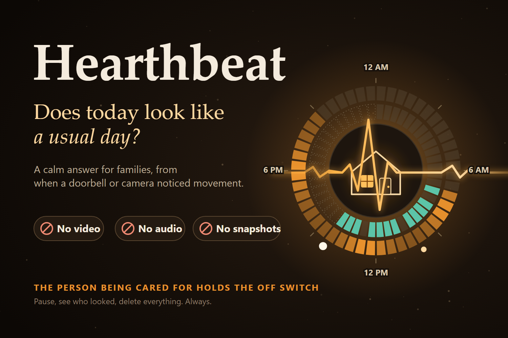
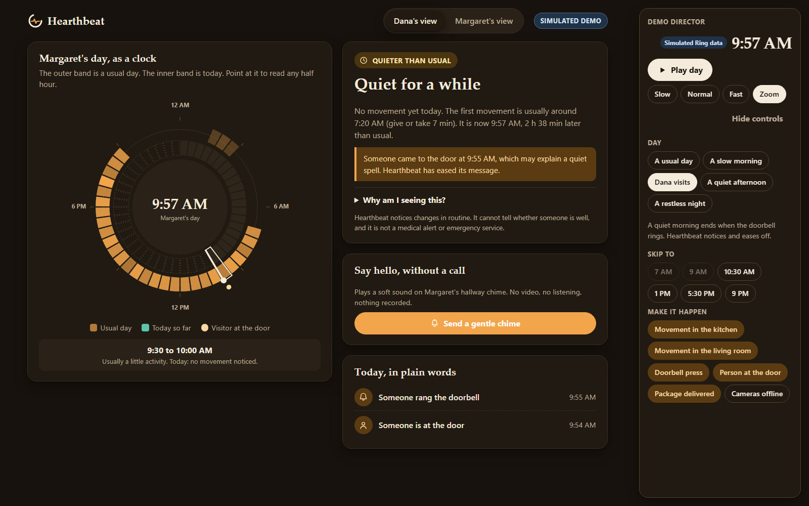
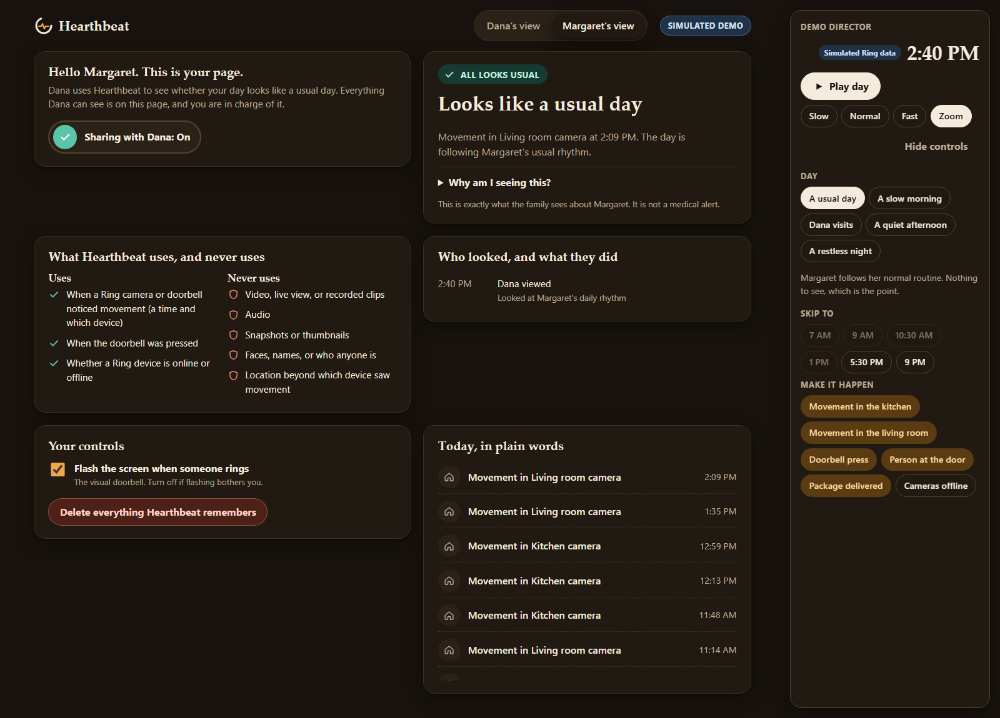
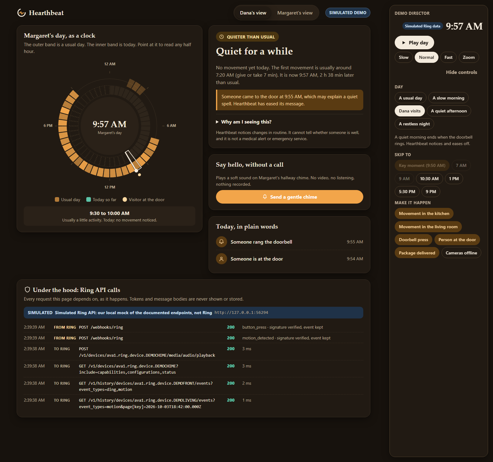

# Hearthbeat



**Live demo: https://hearthbeat-delta.vercel.app** (runs entirely in your browser, nothing to install)

**A calm answer to one question families ask every day: does today look like a usual day?**
Built on Ring event data for the *Build, Ship, Shape: Amazon Developer Hackathon* (Ring track).
It uses only **when** a Ring camera or doorbell noticed movement. Never video, audio or snapshots.

| Family view | The person's own view |
|---|---|
|  |  |



## The problem

Looking after an older relative from a distance comes with a daily worry. Cameras answer a different
question, and for the person being watched they feel like surveillance. Families want reassurance;
parents want dignity.

## What Hearthbeat does

* **Rhythm Ring:** a 24 hour clock. The outer band is their usual day, learned from two weeks of Ring
  Event History. The inner band is today. Point at it, or use the arrow keys, to read any half hour.
* **One plain answer, with its working:** "Looks like a usual day", "Quieter than usual", "Worth a call",
  and a "Why am I seeing this?" naming the rule and numbers. It says "can't see right now" when devices
  are offline and "still learning" before it has enough history. It is not a medical alert.
* **Gentle chime:** one tap plays a soft sound on their Ring Chime. No video, nothing recorded.
* **Visual doorbell:** doorbell presses become a large, high-contrast banner (flashing optional, respects
  reduced motion) for anyone who cannot hear the chime.
* **Their side of the story:** the person being cared for has their own page. They see everything the
  family sees, an **access log** of every look and chime, a **pause switch** that really stops collection
  (the chime is refused while paused), and **delete everything**.
* **Under the hood:** a live panel of every Ring call and webhook the page depends on (paths, status,
  signature verification; never tokens or bodies), labelled "simulated" in demo mode.
* **Interactive demo:** a built-in director panel to play a simulated day, jump to key moments, and make
  things happen: a doorbell press, a package, cameras going offline.

## Try it in 60 seconds

Fastest: open the hosted demo, https://hearthbeat-delta.vercel.app, and skip to step 1 below. It runs the same application code inside
your browser tab, so every visitor gets a private household and nothing is sent anywhere.

To run it yourself you need [Node.js](https://nodejs.org) 22 or newer. There are **no dependencies to install** and no
credentials to configure.

```bash
git clone https://github.com/shahwfabian/hearthbeat.git
cd hearthbeat
npm start
```

Open http://127.0.0.1:3000 and:

1. Read the headline, then point at the ring.
2. In the **Demo director** panel choose **A slow morning**, then press **Key moment**.
3. Open **Why am I seeing this?**, then press **Send a gentle chime** and confirm.
4. Choose **Dana visits**, press **Key moment**, then **Play day**. The doorbell rings, the banner appears,
   and the message eases.
5. Switch to **Margaret's view** and see the access log. Press the sharing switch, then go back to
   **Dana's view**: the family can no longer see anything, and the chime is disabled.

Useful links (on the hosted demo too): `/?view=person` opens the person's page, `/?intro=0` hides the intro.

> **Everything on screen in demo mode is simulated.** The people and devices are fictional and the
> Ring API is our own local mock of the documented endpoints (labelled "Simulated demo" in the UI). It is
> not an official Ring simulator. See [Live mode](#live-mode-a-real-ring-account) for real data.

## How Ring is used

| Ring capability | Code | Purpose |
|---|---|---|
| `GET /v1/devices?include=status,capabilities` | [`RingClient.listDevices`](server/ring/client.js) | discover devices, online state, find the chime |
| `GET /v1/history/devices/{id}/events` (`event_types`, `links.next`) | [`RingClient.getEventHistory`](server/ring/client.js) | learn the usual day; poll for new events in live mode |
| `GET /v1/devices/{id}/status` | [`RingClient.getStatus`](server/ring/client.js) | online and snooze state |
| `POST /v1/devices/{id}/media/audio/playback` | [`RingClient.playChime`](server/ring/client.js) | the gentle chime |
| Webhooks v1.1 with `X-Signature` HMAC | [`createWebhookReceiver`](server/ring/receiver.js) | real-time doorbell and activity events |

Hearthbeat never calls the live video, clip or snapshot endpoints.

## Architecture

```
 Ring API / mock ──► RingClient ─┐
 Ring webhooks ───► receiver ────┴─► Hub ──► rules engine ──► HTTP + SSE ──► browser
                                     │  (events in memory, pause switch, access log, nudge guards)
                                     └─ simulator + clock (demo mode only)
```

Details in [docs/ARCHITECTURE.md](docs/ARCHITECTURE.md). Privacy and consent design in
[docs/PRIVACY.md](docs/PRIVACY.md).

## Live mode: a real Ring account

```bash
cp .env.example .env     # then edit .env
npm run live
```

You need a token from the Ring Developer Playground and the ids of your devices. Step by step, with
caveats, in [docs/LIVE_MODE.md](docs/LIVE_MODE.md). Only connect an account whose owner has agreed.

## Checks and tests

```bash
npm run check    # hygiene checks (syntax, CSP-safe markup, secrets, links) + all tests
npm test         # tests only
```

The suite has more than 180 tests, run with the built-in Node test runner. They cover signature verification, webhook
parsing and replay protection, the Ring client (retries, paging, chime guards), the rhythm engine, the
mock API driven by the real client, the HTTP server end to end (signed webhooks, scenarios, consent,
server-sent events), and every demo scenario across 60 calendar days.

## Project layout

```
server/ring/    Ring client, webhook signing, parsing, receiver
server/core/    baseline, rules, status (pure functions)
server/sim/     demo only: household, scenarios, mock Ring API, signed webhook emitter
server/hub.js   state, consent, access log, nudge
public/         the interface (plain ES modules, SVG, strict CSP)
docs/           architecture, privacy, live mode, demo script, video plan, submission pack, thumbnail
scripts/        project checks and the thumbnail generator
```

## Limitations and assumptions

* Demo mode runs against **our mock**, written from Ring's public documentation. Live mode is written
  against the same documentation and tested against the mock; it has **not** been run against a real Ring
  account by the authors.
* Real webhooks need a registered Ring app (for the signing key) and a public HTTPS URL.
* A doorbell sees comings and goings, not wellbeing. The rhythm works best from an *indoor* device.
  Hearthbeat notices changes in routine and cannot tell whether someone is well.
* Event History only returns events after consent, so a new link spends its first days "learning".
* Ring currently supports devices located in the US. Times use the `HOUSEHOLD_TZ` zone.
* Events are held in memory and lost on restart; live mode re-reads history on start.

## AI assistance disclosure

This project was written with the help of an AI coding assistant, in small reviewed steps that you can
follow in the commit history. The author is responsible for the design and the final review.

## License

[MIT](LICENSE). Ring, Amazon and related names belong to their owners; this project is not affiliated with
or endorsed by them. Hearthbeat uses no third-party logos.
